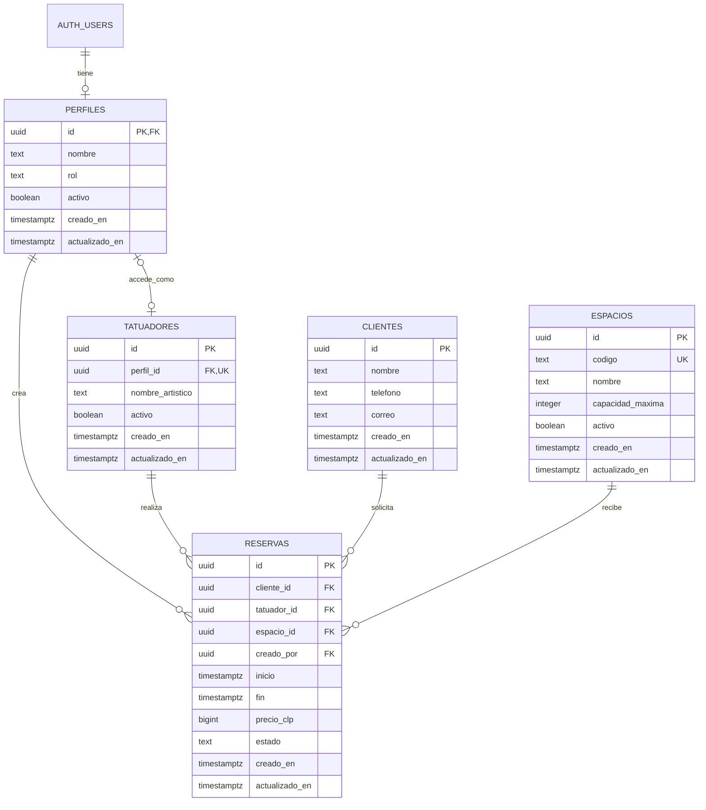

# Diseño propuesto de base de datos — Okami

Fecha: 28 de octubre de 2026. Motor: PostgreSQL en Supabase.

Este documento es una propuesta de diseño basada en el código actual. No crea tablas, no cambia el funcionamiento de la aplicación y no constituye una migración ejecutable.

## Alcance inicial

Usuarios administrador y tatuador, catálogo de tatuadores, clientes, espacios y reservas. Los clientes no necesitan una cuenta. Pagos, abonos, documentos y notificaciones quedan fuera de esta primera versión; el precio de una reserva no representa un pago recibido.

## Relaciones

PK = identificador único. FK = referencia a otra tabla. UK = valor único.

## Diccionario de datos

Todos los campos son obligatorios salvo los indicados como opcionales. Los identificadores nuevos usan UUID generados por la base de datos. Las fechas de auditoría se generan en el servidor; `actualizado_en` se mantiene con un trigger.

### auth.users — cuentas, administradas por Supabase

Supabase Auth administra el correo de acceso, credenciales y sesiones. No crearemos columnas de contraseñas en las tablas de la app ni copiaremos las contraseñas de los JSON. `perfiles.id` referencia su clave primaria `auth.users.id` y utiliza exactamente el mismo UUID.

### perfiles — usuarios de la aplicación

| Campo | Tipo | Regla |
| --- | --- | --- |
| id | uuid | PK y FK a auth.users.id; sin UUID independiente |
| nombre | text | No vacío |
| rol | text | `admin` o `tatuador`; sin ascenso por edición propia |
| activo | boolean | Por defecto true; comprobado en cada operación protegida |
| creado_en | timestamptz | Por defecto now() |
| actualizado_en | timestamptz | Por defecto now() y trigger de actualización |

Las cuentas se crean o invitan mediante un flujo administrativo. El rol lo asigna una operación confiable; no se acepta desde metadatos editables por el usuario. Un perfil inactivo pierde acceso aunque conserve una sesión válida.

### tatuadores — catálogo profesional

| Campo | Tipo | Regla |
| --- | --- | --- |
| id | uuid | PK |
| perfil_id | uuid | FK a perfiles.id, UNIQUE, opcional |
| nombre_artistico | text | No vacío; no es identificador único |
| activo | boolean | Por defecto true |
| creado_en / actualizado_en | timestamptz | Auditoría |

Permite registrar artistas antes de darles acceso. Un perfil puede estar vinculado como máximo a una ficha de tatuador. Un administrador que también tatúe puede tener una ficha vinculada. Un perfil de rol tatuador necesita dicha vinculación para gestionar sus reservas. La vinculación la administra el administrador.

### clientes — personas que reservan

| Campo | Tipo | Regla |
| --- | --- | --- |
| id | uuid | PK |
| nombre | text | No vacío |
| telefono | text | Opcional; texto para conservar prefijos y signos |
| correo | text | Opcional; contacto, independiente del acceso |
| creado_en / actualizado_en | timestamptz | Auditoría |

No se exige correo ni teléfono porque hoy el formulario solo solicita nombre. No se impone unicidad a nombre, teléfono o correo: puede haber homónimos o contactos compartidos. La importación no debe fusionar personas solo por coincidencia de nombre.

### espacios — sectores del estudio

| Campo | Tipo | Regla |
| --- | --- | --- |
| id | uuid | PK |
| codigo | text | UNIQUE, no vacío: A, B, C, D, E o F inicialmente |
| nombre | text | No vacío |
| capacidad_maxima | integer | Mayor que cero |
| activo | boolean | Por defecto true |
| creado_en / actualizado_en | timestamptz | Auditoría |

Datos iniciales: A = 3, B = 2, C = 4, D = 1, E = 2, F = 3. Cada reserva consume un cupo; los acompañantes no cuentan como reservas adicionales en este modelo.

### reservas — sesión de tatuaje

| Campo | Tipo | Regla |
| --- | --- | --- |
| id | uuid | PK |
| cliente_id | uuid | FK a clientes.id |
| tatuador_id | uuid | FK a tatuadores.id |
| espacio_id | uuid | FK a espacios.id |
| creado_por | uuid | FK a perfiles.id; asignado por el servidor, inmutable |
| inicio | timestamptz | Fecha y hora de inicio |
| fin | timestamptz | Posterior a inicio |
| precio_clp | bigint | Pesos chilenos enteros, mayor o igual a cero |
| estado | text | `pendiente`, `completado` o `cancelado`; por defecto `pendiente` |
| creado_en / actualizado_en | timestamptz | Auditoría; creación inmutable |

La interfaz seguirá mostrando Pendiente, Completado y Cancelado. Las relaciones evitan identificar al tatuador por su nombre y duplicar nombres/contactos en cada reserva. Cambiar el nombre de un cliente o tatuador cambia su presentación en reservas anteriores; una copia histórica del nombre queda fuera del alcance inicial.

## Horarios y capacidad

1. Guardar instantes con `timestamptz`, y convertir fechas y horas de la interfaz usando `America/Santiago`. No fijar UTC-3: el desfase depende de la fecha.
2. Mantener la regla actual de inicio y fin dentro del mismo día local; comprobarla en el servidor usando esa zona horaria.
3. Usar intervalos `[inicio, fin)`: una sesión de 15:00 a 17:00 permite otra desde las 17:00.
4. Las canceladas no consumen capacidad. Las completadas conservan su ocupación histórica durante su intervalo, igual que la comprobación horaria actual.
5. La ocupación horaria se calcula a partir de las reservas; no se guarda un contador que pueda quedar desactualizado.
6. No basta contar todas las reservas que tocan el intervalo nuevo: se debe calcular el máximo simultáneo dentro de él, como hace `spaceOccupancy.js`.

### Decisión de negocio antes de implementar

Actualmente el código aplica DOS límites: el máximo de sesiones simultáneas y un máximo global de reservas pendientes por espacio, aunque correspondan a fechas diferentes. Conservar ese comportamiento requiere validar ambos límites en el servidor.

Propuesta para revisar: usar solo capacidad por fecha y horario. Así, un espacio de capacidad 1 podría reservarse hoy y mañana sin tener que completar primero la sesión de hoy. Esto supone un cambio de comportamiento y no queda aplicado por este documento.

También propongo impedir sesiones superpuestas para el mismo tatuador, aunque estén en distintos espacios. Es una regla adicional que el prototipo actual no verifica y debe confirmarse antes de implementarse.

### Reservas simultáneas de distintos usuarios

La validación final debe ser transaccional. Dos usuarios no pueden consultar el último cupo libre y reservarlo ambos. Propuesta técnica: función de base de datos para crear/editar que compruebe permisos, bloquee las filas de espacios afectados en orden estable, vuelva a calcular capacidad y guarde en la misma transacción. Para un traslado, bloquear espacio anterior y nuevo. Los cambios de estado y de capacidad deben participar en la misma disciplina de bloqueo. Si se incorpora el límite por tatuador, bloquear también los tatuadores afectados o utilizar una restricción de exclusión adecuada.

No permitir escrituras directas que evadan estas comprobaciones. Si se usa una función con privilegios elevados, debe fijar `search_path`, validar al solicitante explícitamente y tener permisos de ejecución restringidos. Una restricción simple de no superposición por espacio no sirve para espacios con varios cupos.

## Permisos propuestos

RLS habilitado en todas las tablas públicas. Sin acceso anónimo. Las políticas requieren perfil activo. RLS limita filas; para limitar columnas usar permisos de columnas, proyecciones seguras u operaciones controladas.

| Recurso | Administrador activo | Tatuador activo |
| --- | --- | --- |
| Perfiles | Gestionar mediante operaciones controladas | Consultar su perfil; editar solo su nombre |
| Tatuadores | Crear, vincular cuentas y activar/desactivar | Consultar catálogo básico para calendario |
| Espacios | Gestionar catálogo y capacidad con validación | Consultar |
| Clientes | Gestionar | Consultar clientes vinculados a sus reservas; crear al reservar; sin editar clientes compartidos en el MVP |
| Reservas completas | Consultar y gestionar todas | Consultar, crear, editar y eliminar solo las propias |
| Agenda compartida | Consultar | Ver tatuador, espacio, horario y estado de otras sesiones |

El calendario actual presenta también datos de cliente y precio. Propongo que la agenda compartida excluya esos campos para reservas ajenas. Esta reducción debe reflejarse en la interfaz; no basta ocultarlos visualmente si la API los devuelve. Una operación de lectura controlada puede entregar solo los campos de agenda a usuarios activos, sin conceder acceso a la reserva completa.

Al crear una reserva como tatuador se obtiene `tatuador_id` desde su vinculación autenticada. Al editar no puede cambiarla a otro artista. `creado_por` proviene de la identidad verificada; el cliente no elige ese valor. Para nuevos clientes, crear cliente y reserva en la misma transacción evita registros huérfanos. Si se permite seleccionar clientes existentes, comprobar su acceso sin exponer el catálogo completo.

La desactivación de un tatuador o espacio impide nuevas asignaciones, pero conserva el historial. La edición de una reserva existente con una entidad inactiva debe permitir cancelarla o completarla sin exigir reactivar la entidad.

## Integridad, eliminación e índices

- FK con eliminación restringida para perfiles, tatuadores, clientes y espacios que tengan reservas. No borrar reservas en cascada al borrar una cuenta. Priorizar desactivación y conservar autores.
- Para el MVP, eliminar una reserva sigue siendo una operación física permitida al administrador o al tatuador propietario, como en la app actual. Registrar auditoría de cambios o usar borrado lógico sería una ampliación posterior.
- Checks para nombres no vacíos, capacidad positiva, importe no negativo, estados/roles válidos e intervalo válido.
- Índices B-tree sobre `reservas(cliente_id)`, `reservas(creado_por)`, `reservas(tatuador_id, inicio)`, `reservas(espacio_id, inicio)` y `reservas(inicio)`. Considerar índice GiST de intervalos si el volumen lo justifica.
- `tatuadores(perfil_id)` y `espacios(codigo)` ya quedan indexados por sus restricciones UNIQUE.
- Los cambios de capacidad deben rechazar una reducción por debajo de la ocupación de reservas no canceladas afectadas; si se conserva el límite global de pendientes, validarlo también.
- No guardar totales del dashboard ni ocupación como tablas: se obtienen mediante consultas autorizadas sobre reservas.

## Correspondencia con el prototipo

| Dato actual | Destino |
| --- | --- |
| user.id | perfiles.id, UUID de Auth |
| user.name / user.role | perfiles.nombre / perfiles.rol |
| tatuadoresMock.id / nombre | tatuadores.id / nombre_artistico; mantener mapa de IDs al importar |
| reserva.cliente | clientes.nombre, referenciado por cliente_id |
| reserva.tatuador / tatuadorId | tatuadores.nombre_artistico / tatuador_id |
| espacioId A–F | Resolver espacios.codigo y guardar espacios.id |
| fecha + horaInicio / horaFin | inicio / fin, interpretados en America/Santiago |
| precio | precio_clp |
| estado | estado, normalizado a minúsculas |
| fechaCreacion | creado_en, interpretando explícitamente la zona si no trae desfase |

Los IDs numéricos de los mocks no son IDs de Auth. No asumir que un nombre identifica a una persona de forma única. Los datos de demostración deben cargarse en un proyecto de desarrollo y validarse contra las reglas de capacidad; no se presupone que todos sean importables sin ajustes.

## Orden de implementación

1. Confirmar alcance y decisiones de capacidad, doble reserva de tatuador y privacidad de agenda.
2. Crear migraciones SQL versionadas, restricciones, índices y datos iniciales de espacios.
3. Configurar Auth, perfiles y vinculación de tatuadores mediante operaciones administrativas.
4. Implementar RLS y operaciones transaccionales de reservas.
5. Integrar React y FastAPI; sustituir los JSON/localStorage como fuente de datos.
6. Probar aislamiento entre usuarios, permisos de rol, horario de verano, edición/traslado de reservas y dos solicitudes simultáneas al último cupo.

## Referencias

- Supabase, perfiles vinculados a Auth: https://supabase.com/docs/guides/auth/managing-user-data
- Supabase, Row Level Security: https://supabase.com/docs/guides/database/postgres/row-level-security
- PostgreSQL, intervalos y restricciones de exclusión: https://www.postgresql.org/docs/current/rangetypes.html
